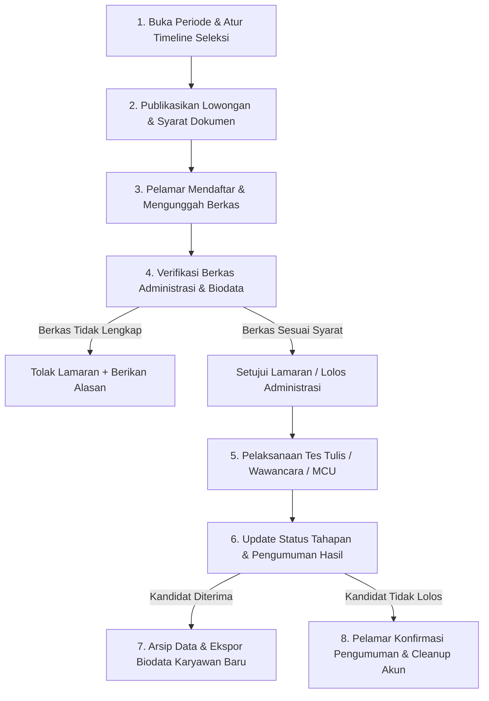

# Buku Panduan Pengguna (User Guide)
## Sistem Informasi Rekrutmen Karyawan — RSI Fatimah Banyuwangi
### *Khusus Tim Administrator HRD / SDI (Super User)*

---

## Daftar Isi
1. [Pendahuluan & Hak Akses Administrator](#1-pendahuluan--hak-akses-administrator)
2. [Alur Kerja Utama Tim SDI (Workflow Overview)](#2-alur-kerja-utama-tim-sdi-workflow-overview)
3. [Modul 1: Autentikasi & Masuk ke Panel Admin](#modul-1-autentikasi--masuk-ke-panel-admin)
4. [Modul 2: Dashboard Rekrutmen SDI](#modul-2-dashboard-rekrutmen-sdi)
5. [Modul 3: Manajemen Lowongan Kerja & Formasi SDM](#modul-3-manajemen-lowongan-kerja--formasi-sdm)
   - 3.1 [Melihat Daftar Lowongan](#31-melihat-daftar-lowongan)
   - 3.2 [Membuka Formasi Lowongan Baru](#32-membuka-formasi-lowongan-baru)
   - 3.3 [Preset Dokumen & Kualifikasi Khusus](#33-preset-dokumen--kualifikasi-khusus)
   - 3.4 [Pengaturan Tahapan Seleksi Formasi](#34-pengaturan-tahapan-seleksi-formasi)
   - 3.5 [Mengubah, Menutup, & Menghapus Formasi](#35-mengubah-menutup--menghapus-formasi)
6. [Modul 4: Manajemen Lamaran & Verifikasi Berkas](#modul-4-manajemen-lamaran--verifikasi-berkas)
   - 4.1 [Navigasi & Multi-Filter Berkas Lamaran](#41-navigasi--multi-filter-berkas-lamaran)
   - 4.2 [Ekspor Biodata Pelamar ke Excel (.xlsx)](#42-ekspor-biodata-pelamar-ke-excel-xlsx)
   - 4.3 [Pemeriksaan Profil & Riwayat Lengkap Pelamar (Tab 1)](#43-pemeriksaan-profil--riwayat-lengkap-pelamar-tab-1)
   - 4.4 [Verifikasi Berkas Dokumen Persyaratan (Tab 2)](#44-verifikasi-berkas-dokumen-persyaratan-tab-2)
   - 4.5 [Fitur Unggulan: Modal Previewer & Download Paket ZIP](#45-fitur-unggulan-modal-previewer--download-paket-zip)
   - 4.6 [Keputusan Verifikasi Administrasi (Lolos / Tolak)](#46-keputusan-verifikasi-administrasi-lolos--tolak)
7. [Modul 5: Pembaruan Tahapan Seleksi & Pengumuman Hasil](#modul-5-pembaruan-tahapan-seleksi--pengumuman-hasil)
   - 5.1 [Pemantauan Stepper Seleksi Pelamar (Tab 3)](#51-pemantauan-stepper-seleksi-pelamar-tab-3)
   - 5.2 [Pembaruan Status Tahapan (Tes Tulis, Interview, MCU)](#52-pembaruan-status-tahapan-tes-tulis-interview-mcu)
   - 5.3 [Validasi Batas Kuota Penerimaan Karyawan](#53-validasi-batas-kuota-penerimaan-karyawan)
   - 5.4 [Pengiriman Notifikasi Otomatis](#54-pengiriman-notifikasi-otomatis)
8. [Modul 6: Manajemen Timeline & Kalender Seleksi](#modul-6-manajemen-timeline--kalender-seleksi)
   - 6.1 [Konsep Date-Driven Lock (Kunci Otomatis Berbasis Waktu)](#61-konsep-date-driven-lock-kunci-otomatis-berbasis-waktu)
   - 6.2 [Pengaturan Jadwal Periode Rekrutmen](#62-pengaturan-jadwal-periode-rekrutmen)
9. [Modul 7: Pengelolaan Siklus Akun Pengguna (User Lifecycle)](#modul-7-pengelolaan-siklus-akun-pengguna-user-lifecycle)
   - 7.1 [Kebijakan Arsip Pelamar Lolos (Calon Karyawan)](#71-kebijakan-arsip-pelamar-lolos-calon-karyawan)
   - 7.2 [Ekspor Biodata Calon Karyawan Diterima](#72-ekspor-biodata-calon-karyawan-diterima)
   - 7.3 [Kebijakan Pembersihan Data Pelamar Tidak Lolos](#73-kebijakan-pembersihan-data-pelamar-tidak-lolos)
   - 7.4 [Pembersihan Massal Pelamar Terkonfirmasi (Cleanup All Seen)](#74-pembersihan-massal-pelamar-terkonfirmasi-cleanup-all-seen)
10. [Standar Operasional Prosedur (SOP) & Best Practices SDI](#10-standar-operasional-prosedur-sop--best-practices-sdi)
11. [Tanya Jawab & Pemecahan Masalah (FAQ)](#11-tanya-jawab--pemecahan-masalah-faq)

---

## 1. Pendahuluan & Hak Akses Administrator

Sistem Informasi Rekrutmen Karyawan RSI Fatimah Banyuwangi dirancang untuk mengoptimalkan proses penerimaan calon tenaga kesehatan maupun non-kesehatan secara terintegrasi, transparan, objektif, dan akuntabel.

Panel Admin dikhususkan bagi **Tim Sumber Daya Insani (SDI / HRD)** dan pimpinan rumah sakit yang memiliki wewenang untuk:
- Mengonfigurasi periode rekrutmen dan tanggal kunci seleksi.
- Mengelola pembukaan formasi lowongan kerja serta kualifikasi yang dipersyaratkan.
- Memeriksa validitas dokumen fisik dan kelengkapan biodata pelamar.
- Mengubah status kelulusan di setiap tahapan seleksi (Administrasi, Ujian Tulis, Wawancara, MCU, hingga Kelulusan Akhir).
- Mengunduh rekap biodata pelamar dalam format Excel (.xlsx) dan paket arsip berkas fisik (.zip).
- Menjalankan pembersihan data pasca-seleksi sesuai standar perlindungan data pribadi kandidat.

---

## 2. Alur Kerja Utama Tim SDI (Workflow Overview)

---

## Modul 1: Autentikasi & Masuk ke Panel Admin

### 1.1 Masuk (Login) ke Sistem
1. Buka peramban (*browser*) dan akses halaman utama sistem atau langsung menuju tautan `/masuk`.
2. Masukkan kredensial akun administrator Anda:
   - **Email**: Alamat email resmi administrator SDI (misal: `admin@rsifatimah.com` atau email yang didaftarkan sebagai super user).
   - **Password**: Kata sandi rahasia akun admin.
3. Klik tombol **Masuk**.
4. Sistem akan secara otomatis mengenali peran (*role*) Anda sebagai `admin` dan mengarahkan Anda langsung ke **Dashboard SDI** (`/admin/dashboard`).

> **Catatan Keamanan**:
> - Jangan pernah membagikan kata sandi admin kepada pihak yang tidak berkepentingan.
> - Jika meninggalkan komputer kerja, pastikan untuk selalu menekan tombol **Keluar** pada pojok kanan atas sidebar.

---

## Modul 2: Dashboard Rekrutmen SDI

Dashboard SDI merupakan pusat kendali pemantauan seluruh aktivitas rekrutmen yang sedang berlangsung. Halaman ini dapat diakses melalui menu **Dashboard SDI** (`/admin/dashboard`).

### 2.1 Komponen & Statistik Utama
1. **Header & Status Periode Aktif**:
   - Menampilkan nama periode seleksi yang sedang berjalan (misal: *Rekrutmen Tenaga Kesehatan Triwulan I 2026*).
   - Terdapat tombol pintas **Buat Lowongan Baru** untuk membuka formasi baru secara cepat.
2. **Empat Kartu Metrik Utama**:
   - **Total Pelamar**: Jumlah total akun pelamar terdaftar serta total berkas lamaran yang masuk ke sistem.
   - **Menunggu Verifikasi**: Jumlah berkas pelamar yang telah di-submit dan menunggu peninjauan oleh tim SDI (dilengkapi tautan cepat *Periksa Berkas &rarr;*).
   - **Lolos Administrasi**: Jumlah berkas yang telah dinyatakan memenuhi syarat dan siap masuk ke tahapan seleksi kompetensi berikutnya.
   - **Tidak Lolos / Ditolak**: Jumlah berkas yang ditolak karena tidak memenuhi kualifikasi atau dokumen tidak lengkap.
3. **Metrik Sekunder**:
   - Jumlah lowongan aktif vs total lowongan.
   - Kandidat dalam tahap tes kompetensi / wawancara / MCU.
   - Kandidat yang telah dinyatakan diterima (*accepted*).
   - Jumlah pelamar yang masih berstatus draf (belum melakukan final submit).
4. **Tabel Lamaran Masuk Terbaru**:
   - Menampilkan 8 berkas lamaran terbaru yang siap diperiksa.
   - Dilengkapi filter cepat berdasarkan formasi tertentu.
   - Menampilkan nama pelamar, posisi formasi, tanggal submit, badge status, dan tombol aksi cepat **Periksa**.

---

## Modul 3: Manajemen Lowongan Kerja & Formasi SDM

Modul ini digunakan untuk merilis posisi baru yang dibutuhkan oleh RSI Fatimah Banyuwangi, menentukan kualifikasi khusus, dan mengatur berkas dokumen yang wajib diunggah pelamar.

### 3.1 Melihat Daftar Lowongan
Akses menu **Lowongan SDM** (`/admin/jobs`). Pada halaman ini Anda dapat:
- Melakukan pencarian berdasarkan nama formasi, kode posisi, unit/departemen, maupun jenis formasi.
- Memfilter formasi berdasarkan status publikasi: **Aktif / Dipublikasikan** atau **Nonaktif / Ditutup**.
- Melihat kuota penerimaan dan jumlah pelamar yang telah masuk pada setiap formasi.
- Mengakses tombol aksi: **Detail Formasi**, **Ubah (Edit)**, **Toggle Publikasi (Buka/Tutup)**, dan **Hapus**.

### 3.2 Membuka Formasi Lowongan Baru
Klik tombol **Tambah Lowongan Baru** (`/admin/jobs/create`). Formulir terdiri dari 4 bagian utama:

#### Bagian 1: Data Formasi & Posisi
- **Periode Rekrutmen**: Pilih periode seleksi aktif yang menaungi lowongan ini.
- **Nama Posisi Formasi**: Masukkan nama jabatan (contoh: *Perawat Pelaksana IGD*, *Apoteker Klinis*, *Staf IT Programmer*).
- **Unit / Departemen**: Tentukan unit penempatan kerja (contoh: *Instalasi Gawat Darurat*, *Instalasi Farmasi*, *Bagian Umum & TI*).
- **Jenis Formasi**: Pilih kategori ketenagaan:
  - Tenaga Medis (Dokter Umum, Dokter Spesialis)
  - Tenaga Keperawatan (Ners, Perawat Pelaksana D3)
  - Tenaga Kebidanan (Bidan Pelaksana)
  - Tenaga Kefarmasian (Apoteker, Tenaga Teknis Kefarmasian)
  - Tenaga Penunjang Medis (Radiografer, Analis Kesehatan / ATLM, Fisioterapi)
  - Tenaga Non-Medis / Umum (IT, Keuangan, Administrasi, Rekam Medis)
  - PKWT atau PKWTT
- **Kuota Penerimaan**: Masukkan jumlah personel yang dibutuhkan (contoh: `2` orang). Kuota ini akan menjadi batas maksimal kelulusan akhir.
- **Tanggal Mulai Pendaftaran**: Tanggal formasi mulai dapat dilamar oleh publik.
- **Batas Akhir Pendaftaran (Deadline)**: Tanggal dan jam terakhir pendaftaran ditutup secara otomatis.
- **Ringkasan Formasi**: Deskripsi singkat untuk tampilan kartu preview lowongan di beranda publik.
- **Deskripsi & Tanggung Jawab Utama**: Uraian lengkap mengenai tugas pokok, fungsi, dan kriteria umum.

#### Bagian 2: Kualifikasi Khusus
- Daftar poin persyaratan kualifikasi pelamar (contoh: *Pendidikan minimal D3/S1*, *Memiliki STR aktif*, *IPK minimal 3.00*, *Usia maksimal 30 tahun*).
- Anda dapat menekan tombol **+ Tambah Kualifikasi** untuk menambah poin kualifikasi baru atau tombol tempat sampah untuk menghapus poin.

#### Bagian 3: Persyaratan Dokumen yang Wajib Diunggah
Setiap posisi membutuhkan kelengkapan berkas yang berbeda. Anda dapat memanfaatkan fitur **Preset Cepat**:
1. **Preset Tenaga Medis / Keperawatan**:
   - Surat Lamaran Kerja (Wajib, PDF)
   - Ijazah Profesi / Terakhir Legalisir (Wajib, PDF)
   - Transkrip Nilai Akademik Legalisir (Wajib, PDF)
   - STR (Surat Tanda Registrasi) Aktif (Wajib, PDF)
   - Sertifikat Pelatihan Keahlian (ACLS/BTCLS) (Opsional, PDF)
   - SKCK Kepolisian Aktif (Opsional, PDF)
2. **Preset Tenaga Umum / IT / Administrasi**:
   - Surat Lamaran Kerja (Wajib, PDF)
   - Curriculum Vitae (CV) & Portofolio (Wajib, PDF)
   - Ijazah & Transkrip Terakhir (Wajib, PDF)
   - KTP & Kartu Keluarga (Wajib, PDF)
   - Sertifikat Keahlian / Kompetensi IT / Akuntansi (Opsional, PDF)
   - SKCK Kepolisian (Opsional, PDF)
3. **Kustom Dokumen**: Anda dapat menambah atau mengurangi dokumen sesuka hati, menentukan batas maksimal ukuran berkas (standar: 5 MB / 5120 KB), dan mengatur apakah dokumen bersifat **Wajib** atau **Opsional**.

#### Bagian 4: Pengaturan Tahapan Seleksi Formasi
Secara bawaan (*default*), sistem menyusun alur standar rumah sakit:
1. Pendaftaran Online & Review Portofolio
2. Seleksi Administrasi & Verifikasi Berkas
3. Ujian Tulis & Kompetensi Bidang
4. Wawancara SDI & Direksi
5. Medical Check-Up (MCU) & Pengumuman Akhir
*Setiap tahapan dapat disesuaikan nama, deskripsi, tanggal mulai, dan tanggal selesainya.*

#### Bagian 5: Status Publikasi
- Centang opsi **Publikasikan Lowongan Langsung** jika formasi ingin langsung tayang di portal publik, atau hilangkan centang jika ingin menyimpannya sebagai draf terlebih dahulu.
- Klik **Simpan & Publikasikan Lowongan**.

---

## Modul 4: Manajemen Lamaran & Verifikasi Berkas

Modul ini adalah jantung operasional tim SDI dalam menyaring kandidat, memvalidasi berkas asli, dan menentukan siapa yang berhak maju ke tahapan berikutnya. Akses menu **Lamaran Pelamar** (`/admin/applications`).

### 4.1 Navigasi & Multi-Filter Berkas Lamaran
Di bagian atas halaman terdapat panel ringkasan status lamaran:
- **Total Berkas**
- **Perlu Verifikasi** (Menunggu tindakan verifikator)
- **Lolos Administrasi**
- **Tahap Tes/MCU** (Dalam proses seleksi berjalan)
- **Diterima** (Lolos akhir)
- **Tidak Lolos**

Gunakan form pencarian interaktif untuk:
- Mengetik kata kunci pencarian (Nama Pelamar, Email, Nomor Registrasi, Nomor Lamaran, atau Nomor Telepon).
- Memfilter berkas berdasarkan **Posisi Formasi**.
- Memfilter berkas berdasarkan **Status Lamaran**.
- Halaman akan memfilter secara otomatis seketika (*auto-filter*) tanpa memuat ulang seluruh halaman.

### 4.2 Ekspor Biodata Pelamar ke Excel (.xlsx)
Untuk mempermudah rekapitulasi, rapat pleno panitia, atau pelaporan direksi:
1. Terapkan filter yang diinginkan (misal: hanya formasi *Perawat IGD* yang berstatus *Lolos Administrasi*), atau biarkan kosong untuk mengunduh seluruh data.
2. Klik tombol hijau **Unduh Biodata Pelamar (.xlsx)** di sudut kanan atas.
3. Berkas spreadsheet resmi Excel akan terunduh otomatis, memuat kolom-kolom komprehensif:
   - Nomor Registrasi & Nomor Lamaran Resmi
   - Data Identitas Pribadi (Nama, NIK e-KTP, Tempat/Tgl Lahir, Usia, Gender, Agama, Status Nikah)
   - Kontak Lengkap (Email, No. HP/WhatsApp, Alamat KTP, Alamat Domisili)
   - Pendidikan Terakhir (Jenjang, Universitas, Jurusan, Tahun Lulus, IPK)
   - Informasi STR (No. STR, Masa Berlaku, Status Keaktifan)
   - Ringkasan Pengalaman Kerja & Sertifikasi
   - Status Kelulusan & Catatan Verifikator

### 4.3 Pemeriksaan Profil & Riwayat Lengkap Pelamar (Tab 1)
Klik tombol **Periksa Berkas** pada baris kandidat untuk membuka halaman verifikasi mendalam (`/admin/applications/{id}`).

Halaman verifikasi dibagi menjadi 3 tab utama:
- **Tab 1: Biodata & Riwayat Pelamar**
  - **Identitas Kependudukan**: Memeriksa kesesuaian NIK (terdapat indikator validitas 16 digit), Tempat & Tanggal Lahir, Usia saat melamar, Jenis Kelamin, dan Agama.
  - **Alamat & Kontak**: Alamat sesuai KTP vs Alamat Domisili di Banyuwangi/sekitarnya, Nomor WhatsApp aktif, serta tautan akun LinkedIn/Media Sosial.
  - **Riwayat Pendidikan**: Daftar seluruh jenjang pendidikan yang diisi kandidat (D3, S1, Profesi, S2) lengkap dengan tahun kelulusan dan nilai IPK.
  - **Surat Tanda Registrasi (STR)**: Untuk formasi nakes, tampil informasi Nomor STR, tanggal terbit, masa berlaku, atau status STR Seumur Hidup.
  - **Sertifikasi Keahlian**: Bukti kepemilikan sertifikat klinis (BTCLS, ACLS, K3RS, dll.) atau kompetensi teknis.
  - **Pengalaman Kerja**: Riwayat pekerjaan di rumah sakit atau institusi sebelumnya, posisi jabatan, masa kerja, dan deskripsi tanggung jawab.
  - **Panel Verifikasi Biodata**: Tombol tindakan cepat untuk **Menyetujui Biodata** atau **Menolak Biodata** (wajib mengisi catatan penolakan jika ditolak).

### 4.4 Verifikasi Berkas Dokumen Persyaratan (Tab 2)
Pilih **Tab 2: Verifikasi Berkas Dokumen**. Di tab ini tim SDI dapat:
- Melihat ringkasan berkas yang diunggah kandidat terhadap total syarat (contoh: *6/6 Dokumen Lengkap*).
- Meninjau dokumen satu per satu pada tabel persyaratan:
  - **Nama Dokumen & Keterangan**: Contoh: Surat Lamaran Kerja, Scan Ijazah Asli, dll.
  - **Nama Berkas Fisik & Ukuran**: Format file (.pdf/.jpg/.png) dan ukuran berkas.
  - **Status Validasi**: Berstatus *Valid* (Centang Hijau), *Tidak Valid* (Silang Merah), atau *Menunggu Review* (Kuning).
  - **Formulir Validasi per Dokumen**: Verifikator dapat memilih opsi *Valid*, *Tidak Valid*, atau *Pending* serta memberikan catatan khusus (misal: *"Scan STR buram, mohon perbaiki"*).
- **Tombol Pintas "Validkan Semua Berkas"**: Jika setelah diperiksa seluruh berkas telah memenuhi standar dan terbaca jelas, klik tombol hijau **Validkan Semua Berkas**. Sistem akan secara otomatis mengubah seluruh status dokumen menjadi valid dan meloloskan tahap seleksi administrasi.

### 4.5 Fitur Unggulan: Modal Previewer & Download Paket ZIP
1. **Modal Dokumen Previewer (Inline Document Viewer)**:
   - Verifikator tidak perlu repot membuka tab peramban baru atau mengunduh satu per satu file PDF/gambar ke komputer lokal.
   - Klik tombol **Lihat Dokumen** pada dokumen manapun.
   - Jendela modal pratinjau interaktif akan muncul langsung di layar dengan kontrol *Zoom In*, *Zoom Out*, *Putar*, serta tombol navigasi *Sebelumnya / Berikutnya* untuk memeriksa dokumen berikutnya secara berurutan.
2. **Download Seluruh Berkas Pelamar (.ZIP)**:
   - Klik tombol **Download Semua Dokumen (.ZIP)** pada header tab berkas.
   - Sistem secara cerdas membundel seluruh dokumen yang diunggah pelamar ke dalam satu arsip ZIP dengan struktur penamaan teratur:
     `01_surat_lamaran_kerja.pdf`, `02_ijazah_terakhir.pdf`, dst.
   - Berkas siap dibuka atau diarsipkan secara luring (*offline*).

### 4.6 Keputusan Verifikasi Administrasi (Lolos / Tolak)
Setelah pemeriksaan selesai, tim SDI mengambil keputusan final administrasi:
1. **Jika Memenuhi Syarat (Lolos Seleksi Berkas)**:
   - Klik tombol **Setujui & Loloskan Administrasi**.
   - Masukkan catatan admin jika diperlukan (opsional, contoh: *"Lolos seleksi berkas. Berkas asli harap dibawa saat tes wawancara"*).
   - Status lamaran berubah menjadi **Lolos Administrasi** (`passed_administration`), dan kandidat otomatis dipindahkan ke tahapan seleksi kompetensi formasi.
2. **Jika Tidak Memenuhi Syarat (Ditolak)**:
   - Klik tombol **Tolak Lamaran**.
   - **Wajib mengisi Alasan Penolakan** (contoh: *"IPK di bawah 3.00"*, *"STR sudah kedaluwarsa dan tidak melampirkan bukti perpanjangan"*, atau *"Kualifikasi pendidikan tidak linier"*).
   - Status lamaran berubah menjadi **Tidak Lolos** (`rejected`).
   - Sistem secara otomatis mengirimkan notifikasi resmi ke portal pelamar sehingga kandidat mengetahui transparansi alasan penolakan secara jelas.

---

## Modul 5: Pembaruan Tahapan Seleksi & Pengumuman Hasil

Setelah pelamar dinyatakan lolos seleksi berkas, tahapan berikutnya adalah rangkaian tes kompetensi hingga penetapan kelulusan akhir.

### 5.1 Pemantauan Stepper Seleksi Pelamar (Tab 3)
Buka **Tab 3: Tahapan Seleksi & Timeline** pada halaman detail lamaran:
- Menampilkan grafik alur tahapan seleksi posisi bersangkutan (Pendaftaran &rarr; Administrasi &rarr; Ujian Tulis &rarr; Wawancara &rarr; MCU &rarr; Hasil Akhir).
- Setiap simpul menampilkan status tahapan: *Menunggu*, *Sedang Berjalan*, *Lolos*, atau *Tidak Lolos*.

### 5.2 Pembaruan Status Tahapan (Tes Tulis, Interview, MCU)
1. Pada form **Pembaruan Tahapan Seleksi**:
   - Pilih tahapan seleksi yang dinilai (misal: *Wawancara SDI & Direksi*).
   - Pilih hasil keputusan:
     - **Lolos (Passed)**: Meloloskan kandidat ke tahapan berikutnya.
     - **Tidak Lolos (Failed / Rejected)**: Menghentikan proses kandidat pada tahapan ini.
     - **Sedang Berjalan (In Progress)**: Menandakan kandidat sedang dijadwalkan untuk tes.
     - **Menunggu (Pending)**: Menunda penilaian.
   - Masukkan **Catatan / Instruksi Pengumuman untuk Pelamar**:
     - *Contoh jika dijadwalkan wawancara*: *"Jadwal wawancara pada Kamis, 20 Maret 2026 pukul 09.00 WIB di Ruang Rapat Lt. 2 RSI Fatimah. Harap mengenakan pakaian rapi hitam-putih."*
     - *Contoh jika lolos akhir*: *"Selamat! Anda dinyatakan Lolos Seleksi Akhir Formasi Perawat IGD. Harap hadir untuk penandatanganan kontrak kerja pada Senin depan."*
2. Klik tombol **Simpan & Perbarui Tahapan**.

### 5.3 Validasi Batas Kuota Penerimaan Karyawan
Sistem dilengkapi fitur proteksi cerdas:
- Ketika administrator menetapkan status kandidat menjadi **Diterima (Accepted)** pada tahap akhir, sistem akan menghitung jumlah pelamar yang telah diterima pada formasi tersebut.
- Jika kuota formasi adalah `2` orang dan sudah ada `2` kandidat yang disetujui, sistem akan memblokir upaya meloloskan kandidat ke-3 dengan pesan peringatan:
  > *"Gagal meloloskan: Kuota penerimaan untuk formasi ini telah terpenuhi (2 dari 2 kuota)."*
- Kebijakan ini mencegah terjadinya penerimaan pegawai melebihi alokasi formasi resmi rumah sakit.

### 5.4 Pengiriman Notifikasi Otomatis
Setiap kali status diperbarui oleh tim SDI:
- Lonceng notifikasi di portal pelamar akan otomatis bertambah.
- Pelamar menerima rincian status, tanggal pembaruan, dan catatan instruksi dari panitia seleksi secara *real-time*.

---

## Modul 6: Manajemen Timeline & Kalender Seleksi

Akses menu **Timeline & Jadwal** (`/admin/timelines`) untuk mengontrol jadwal pelaksanaan rekrutmen.

### 6.1 Konsep Date-Driven Lock (Kunci Otomatis Berbasis Waktu)
Sistem Rekrutmen RSI Fatimah beroperasi menggunakan sistem kendali waktu otomatis (*Date-Driven Lock*):
1. **Sebelum Tanggal Buka Pendaftaran (`registration_start_at`)**:
   - Formasi lowongan dapat dilihat publik, tetapi formulir registrasi dan tombol submit dalam status terkunci (*disabled*).
2. **Saat Periode Aktif Berjalan**:
   - Pelamar dapat mendaftar akun, melengkapi biodata, mengunggah berkas persyaratan, dan melakukan submit lamaran.
3. **Melewati Batas Akhir Submit (`registration_end_at` / Deadline)**:
   - Formulir pendaftaran dan tombol submit otomatis terkunci secara permanen.
   - Pelamar tidak lagi dapat mengubah biodata atau mengunggah berkas baru.
   - Tim SDI dapat menjalankan proses verifikasi berkas secara tenang tanpa risiko adanya manipulasi data susulan oleh kandidat.

### 6.2 Pengaturan Jadwal Periode Rekrutmen
Pada halaman ini, administrator dapat:
1. Memperbarui tanggal-tanggal kunci:
   - **Nama Periode Seleksi**
   - **Tanggal Buka Pendaftaran**
   - **Batas Akhir Submit Berkas Pelamar**
   - **Batas Waktu Verifikasi Berkas oleh Tim SDI**
   - **Tanggal Pengumuman Kelulusan Akhir**
   - **Tanggal Berakhirnya Seluruh Rangkaian Seleksi**
2. Mengatur status **Periode Rekrutmen Aktif**:
   - Hanya boleh ada 1 periode berstatus aktif dalam satu waktu.
   - Mengaktifkan periode baru secara otomatis akan mengarsipkan periode lama.
3. Klik tombol **Simpan Jadwal Periode**.

---

## Modul 7: Pengelolaan Siklus Akun Pengguna (User Lifecycle)

Akses menu **Siklus Akun & Arsip** (`/admin/lifecycle`). Modul ini dirancang khusus untuk mematuhi tata kelola data rumah sakit dan privasi pelamar pasca-seleksi berakhir.

Halaman ini terbagi menjadi dua kebijakan utama:

### 7.1 Kebijakan Arsip Pelamar Lolos (Calon Karyawan) — Tab 1
Kandidat yang telah dinyatakan lolos seleksi berkas hingga **Diterima** merupakan aset calon pegawai baru:
- **Prinsip Nonaktif Akun (Deactivation)**: Akun pelamar dinonaktifkan dari portal pendaftaran agar tidak dapat melakukan submit ulang pada periode lain.
- **Integritas Berkas Fisik**: Berbeda dengan akun pelamar gagal, **seluruh dokumen fisik, riwayat pendidikan, STR, dan biodata pelamar lolos TETAP TERSIMPAN UTUH** di direktori server sebagai arsip digital kepegawaian baru rumah sakit.
- **Aksi Tersedia**:
  - **Nonaktifkan Akun (Arsip)**: Menutup akses login pelamar dengan aman.
  - **Aktifkan Kembali**: Jika sewaktu-waktu pelamar membutuhkan akses kembali untuk pemutakhiran data.

### 7.2 Ekspor Biodata Calon Karyawan Diterima
- Pada Tab 1, terdapat tombol **Unduh Biodata Calon Karyawan (.xlsx)**.
- Fitur ini khusus menyaring kandidat berstatus **Diterima** untuk diserahkan ke bagian Penggajian, Diklat, atau Sub-Bagian Kepegawaian sebagai berkas induk karyawan baru.

### 7.3 Kebijakan Pembersihan Data Pelamar Tidak Lolos — Tab 2
Untuk melindungi kerahasiaan data pribadi (*privacy protection*) kandidat yang tidak diterima serta menghemat kapasitas penyimpanan server dari berkas digital yang sudah tidak terpakai:
- Pelamar yang tidak lolos diberikan kesempatan untuk melihat pengumuman resmi di portal pelamar mereka dan mengonfirmasi bahwa mereka telah membaca hasil tersebut (`announcement_seen_at`).
- Administrator dapat melakukan pembersihan data (*hard delete*):
  - Menghapus akun user pelamar.
  - Menghapus catatan biodata, riwayat pendidikan, dan riwayat lamaran.
  - Menghapus seluruh file dokumen fisik (.pdf/.jpg) yang tersimpan di storage server secara permanen.

### 7.4 Pembersihan Massal Pelamar Terkonfirmasi (Cleanup All Seen)
1. Pada Tab 2, periksa indikator **Pelamar Telah Mengonfirmasi Pengumuman**.
2. Klik tombol merah **Pembersihan Massal Berkas Terkonfirmasi**.
3. Sistem secara otomatis menghapus tuntas data dan berkas fisik dari seluruh kandidat gagal yang telah membaca pengumuman, tanpa mengganggu berkas kandidat yang lolos atau yang belum membaca pengumuman.
4. Anda juga dapat melakukan pembersihan individual dengan menekan tombol **Bersihkan Berkas Sekarang** pada baris kandidat tertentu.

---

## 10. Standar Operasional Prosedur (SOP) & Best Practices SDI

Untuk menjaga integritas dan profesionalitas rekrutmen RSI Fatimah Banyuwangi, ikuti pedoman operasional berikut:

### SOP 1: Verifikasi Keabsahan STR Tenaga Kesehatan
1. Buka dokumen STR pelamar melalui modal previewer.
2. Catat Nomor STR dan tanggal lahir pelamar.
3. Lakukan kroscek validitas pada portal resmi pemerintah:
   - Tenaga Medis: Portal Konsil Kedokteran Indonesia (KKI)
   - Tenaga Keperawatan & Penunjang: Portal KTKI (Kementerian Kesehatan)
4. Pastikan status STR terdaftar dan tidak dalam masa sanksi etik profesi.

### SOP 2: Standar Penulisan Catatan Penolakan Berkas
Hindari penolakan tanpa alasan yang jelas. Berikan feedback yang konstruktif dan sopan:
- *Baik*: *"Kualifikasi pendidikan belum sesuai (dibutuhkan D3/S1 Keperawatan, terlampir SMK Kesehatan). Terima kasih atas partisipasi Anda."*
- *Baik*: *"Scan ijazah terpotong pada bagian nomor seri ijazah dan legalisir. Berkas tidak dapat divalidasi keabsahannya."*
- *Hindari*: *"Ditolak"*, *"Berkas jelek"*, atau mengosongkan alasan penolakan.

### SOP 3: Pengamanan Data Rekrutmen
- Lakukan ekspor berkas Excel (.xlsx) secara berkala pada setiap pergantian tahapan seleksi sebagai salinan cadangan (*backup*).
- Sebelum menjalankan pembersihan massal (*cleanup*), pastikan seluruh pelamar yang diterima telah diekspor biodatanya ke sistem kepegawaian induk.

---

## 11. Tanya Jawab & Pemecahan Masalah (FAQ)

### Q1: Mengapa tombol "Final Submit" pelamar tidak aktif?
**Jawaban**: Pastikan dua hal:
1. Tanggal saat ini berada dalam rentang periode rekrutmen aktif (belum melewati batas *deadline*).
2. Kelengkapan profil pelamar telah mencapai 100% dan seluruh dokumen yang bertanda *Wajib* telah diunggah oleh pelamar.

### Q2: Bagaimana cara mengubah kuota formasi jika pendaftaran sudah berjalan?
**Jawaban**: Buka menu **Lowongan SDM**, pilih tombol **Ubah (Edit)** pada formasi bersangkutan, ubah angka pada kolom **Kuota Penerimaan**, lalu klik **Perbarui Lowongan**. Kuota yang baru akan langsung diterapkan oleh sistem.

### Q3: Pelamar salah mengunggah dokumen, apakah admin bisa menggantikannya?
**Jawaban**: Demi akuntabilitas dan integritas data, dokumen hanya dapat diunggah oleh pelamar melalui akun mereka. Selama periode submit masih buka dan berkas belum dikunci, pelamar dapat menghapus dan mengunggah ulang dokumen tersebut. Jika berkas sudah di-submit, admin dapat menolak dokumen tersebut dengan catatan perbaikan agar pelamar mengetahui kendalanya.

### Q4: Apakah data pelamar yang dihapus via menu Lifecycle bisa dikembalikan?
**Jawaban**: **Tidak bisa**. Fitur pembersihan (*cleanup*) melakukan penghapusan fisik secara permanen (*permanent hard delete*) dari basis data dan media penyimpanan server. Pastikan Anda telah melakukan *backup* atau ekspor data sebelum menjalankan pembersihan.

### Q5: Bagaimana jika ada 2 pelamar memiliki nilai tes yang sama pada kuota terakhir?
**Jawaban**: Tim SDI dapat mempertimbangkan kualifikasi pendukung seperti kepemilikan sertifikat keahlian khusus (misal: BTCLS dengan masa berlaku lebih panjang), IPK, atau hasil wawancara komitmen keislaman dan etika kerja rumah sakit sebelum memperbarui status tahapan akhir menjadi *Diterima*.

---

*Buku Panduan Pengguna Admin — Sistem Informasi Rekrutmen RSI Fatimah Banyuwangi*
*Hak Cipta © 2026 RSI Fatimah Banyuwangi. Seluruh Hak Dilindungi.*
