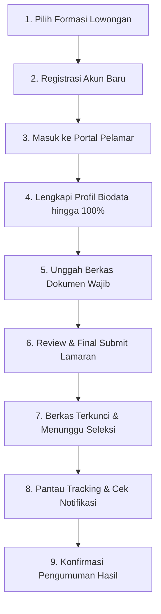

# Buku Panduan Pengguna (User Guide)
## Sistem Informasi Rekrutmen Karyawan — RSI Fatimah Banyuwangi
### *Khusus Portal Pelamar (Applicant Portal)*

---

## Daftar Isi
1. [Tentang Sistem & Ketentuan Umum](#1-tentang-sistem--ketentuan-umum)
2. [Alur Utama Pendaftaran](#2-alur-utama-pendaftaran)
3. [Langkah 1: Eksplorasi Lowongan & Registrasi Akun](#langkah-1-eksplorasi-lowongan--registrasi-akun)
4. [Langkah 2: Masuk (Login) & Pengenalan Dashboard Pelamar](#langkah-2-masuk-login--pengenalan-dashboard-pelamar)
5. [Langkah 3: Pengisian & Pemenuhan Profil Pelamar (Target 100%)](#langkah-3-pengisian--pemenuhan-profil-pelamar-target-100)
6. [Langkah 4: Manajemen Dokumen & Unggah Berkas Persyaratan](#langkah-4-manajemen-dokumen--unggah-berkas-persyaratan)
7. [Langkah 5: Peninjauan (Review) & Final Submit Lamaran](#langkah-5-peninjauan-review--final-submit-lamaran)
8. [Langkah 6: Pemantauan Seleksi (Tracking & Hasil Pengumuman)](#langkah-6-pemantauan-seleksi-tracking--hasil-pengumuman)
9. [Langkah 7: Konfirmasi Pengumuman & Kebijakan Siklus Akun](#langkah-7-konfirmasi-pengumuman--kebijakan-siklus-akun)
10. [Pusat Notifikasi](#10-pusat-notifikasi)
11. [Tanya Jawab & Pemecahan Masalah (FAQ & Troubleshooting)](#11-tanya-jawab--pemecahan-masalah-faq--troubleshooting)

---

## 1. Tentang Sistem & Ketentuan Umum

Sistem Informasi Rekrutmen RSI Fatimah Banyuwangi adalah platform resmi berbasis web yang dirancang untuk memfasilitasi penerimaan calon tenaga kesehatan (medis, paramedis) dan non-kesehatan secara transparan, akuntabel, dan profesional.

### Ketentuan Dasar bagi Pelamar:
- **100% Gratis**: Seluruh tahapan seleksi pegawai RSI Fatimah Banyuwangi **tidak dipungut biaya apapun**. Waspadai penipuan yang mengatasnamakan panitia seleksi.
- **Prinsip 1 Akun = 1 NIK**: Setiap pelamar hanya boleh mendaftar menggunakan 1 Nomor Induk Kependudukan (NIK) e-KTP yang valid.
- **Prinsip 1 Formasi per Periode**: Pelamar hanya dapat mengajukan **1 (satu) lamaran formasi** dalam satu periode rekrutmen aktif.
- **Integritas Dokumen**: Dokumen yang diunggah wajib merupakan dokumen asli hasil pemindaian (*scan*) yang jelas, tidak terpotong, dan dapat dipertanggungjawabkan keasliannya secara hukum.

---

## 2. Alur Utama Pendaftaran

---

## Langkah 1: Eksplorasi Lowongan & Registrasi Akun

### 1.1 Menjelajahi Formasi Lowongan
1. Buka situs web rekrutmen melalui peramban (*browser*) Anda.
2. Klik menu **Lowongan** atau kunjungi tautan `/lowongan`.
3. Anda dapat memfilter posisi berdasarkan unit kerja, kualifikasi pendidikan, maupun status formasi.
4. Klik tombol **Lihat Detail** pada formasi yang diminati untuk memeriksa:
   - Kualifikasi pendidikan minimal dan IPK.
   - Batas usia maksimal.
   - Kebutuhan Surat Tanda Registrasi (STR) bagi profesi kesehatan.
   - Daftar dokumen wajib dan dokumen pendukung yang dipersyaratkan.
   - Tanggal batas akhir pengiriman berkas (*deadline*).

### 1.2 Mendaftar Akun Baru
> **Catatan Penting**: Pendaftaran akun baru di sistem RSI Fatimah terintegrasi langsung dengan posisi yang dipilih.

1. Pada halaman detail formasi lowongan, klik tombol **Lamar Posisi Ini**.
2. Anda akan diarahkan ke formulir **Registrasi Akun Baru** (`/daftar`).
3. Isi data registrasi dengan benar:
   - **Nama Lengkap**: Sesuai dengan yang tertera pada ijazah/KTP.
   - **Alamat Email**: Gunakan email pribadi yang aktif (digunakan untuk notifikasi dan pemulihan kata sandi).
   - **Nomor WhatsApp**: Nomor aktif yang dapat dihubungi panitia rekrutmen.
   - **Kata Sandi (Password)**: Minimal 8 karakter kombinasi huruf dan angka.
   - **Konfirmasi Kata Sandi**: Masukkan kembali kata sandi yang sama.
4. Klik tombol **Daftar Sekarang**.
5. Sistem akan membuat akun Anda, menerbitkan **Nomor Registrasi Resmi** (misal: `REG-2026-XXXX`), dan secara otomatis menyiapkan draf lamaran untuk posisi yang telah Anda pilih.

---

## Langkah 2: Masuk (Login) & Pengenalan Dashboard Pelamar

### 2.1 Masuk ke Akun Anda
1. Buka tautan `/masuk`.
2. Masukkan alamat email dan kata sandi yang telah Anda daftarkan.
3. Klik tombol **Masuk**. Sistem akan secara otomatis mengarahkan Anda ke **Dashboard Portal Pelamar** (`/portal`).

### 2.2 Jika Lupa Kata Sandi
1. Pada halaman login, klik tautan **Lupa Password?**.
2. Masukkan alamat email Anda yang terdaftar, lalu klik **Kirim Tautan Reset Password**.
3. Periksa kotak masuk (atau folder spam/junk) email Anda, buka tautan yang dikirimkan, lalu masukkan kata sandi baru Anda.

### 2.3 Mengenal Antarmuka Dashboard Pelamar
Di halaman `/portal`, Anda akan melihat:
- **Header Pelamar**: Menampilkan nama lengkap, pas foto, alamat email, dan **Nomor Registrasi Pelamar**.
- **Widget Kelengkapan Profil Dasar**: Menampilkan persentase kesiapan data Anda (0% - 100%).
- **Timeline Alur Seleksi Karyawan**: Grafik dinamis tahapan seleksi aktif beserta batas waktu (*deadline*) pengiriman berkas.
- **Kartu Lamaran Aktif**: Menampilkan formasi yang sedang Anda lamar, status saat ini (*Draft*, *Diajukan*, *Diproses*, dll.), serta tombol akses cepat menuju pengisian berkas.

---

## Langkah 3: Pengisian & Pemenuhan Profil Pelamar (Target 100%)

Akses halaman ini melalui menu navigasi **Profil Saya** atau buka tautan `/portal/profil`.

### 💡 Mekanisme Penyimpanan Bertahap (*Incremental Auto-Save*)
Sistem dirancang fleksibel agar pelamar **tidak harus menyelesaikan seluruh data sekaligus dalam satu sesi**:
- **Pas Foto & Data Langsung Tersimpan**: Ketika Anda telah memilih pas foto dan mengisi beberapa data (misalnya nama, NIK, tempat/tanggal lahir, kontak), lalu menekan tombol **"Simpan Data Profil"** atau **tidak sengaja menekan tombol Enter** pada keyboard saat mengetik, **pas foto bersama isian data yang telah diinput akan langsung tersimpan secara aman ke sistem**.
- **Progres Bertambah Sesuai Isian**: Meskipun formulir belum terisi lengkap (misalnya baru 30%, 55%, atau 70%), data yang berhasil masuk tidak akan hilang. Anda dapat keluar (*logout*) dan melanjutkannya kapan saja.
- **Kapan Profil Harus 100%?**: Walaupun data tersimpan secara bertahap, tombol **"Menuju ke Pemberkasan"** serta tahapan **Review & Submit Lamaran** baru akan terbuka aktif setelah indikator profil mencapai **100% Selesai**. Periksa daftar kriteria yang belum lengkap di bagian atas halaman untuk melanjutkan.

### 11 Kriteria Dasar Kelengkapan Profil:
| No | Kriteria | Keterangan & Ketentuan |
|:---:|:---|:---|
| 1 | **Pas Foto Formal** | Format JPG/PNG, ukuran maks. 2 MB. Gunakan foto resmi berlatar belakang rapi. Foto langsung tersimpan saat disimpan. |
| 2 | **Nama Lengkap** | Sesuai dengan e-KTP dan ijazah. |
| 3 | **NIK** | 16 digit Nomor Induk Kependudukan sesuai e-KTP asli. |
| 4 | **Email** | Email aktif terverifikasi pada akun Anda. |
| 5 | **Nomor WhatsApp / HP** | Nomor ponsel aktif yang terhubung WhatsApp. |
| 6 | **Tempat Lahir** | Nama kota/kabupaten tempat Anda dilahirkan. |
| 7 | **Tanggal Lahir** | Format tanggal/bulan/tahun sesuai KTP. |
| 8 | **Jenis Kelamin** | Laki-laki / Perempuan. |
| 9 | **Alamat Sesuai KTP** | Alamat lengkap termasuk RT/RW, kelurahan, kecamatan, dan kota/kabupaten. |
| 10 | **Alamat Domisili** | Tempat tinggal Anda saat ini (centang "Sama dengan KTP" jika tidak berbeda). |
| 11 | **Minimal 1 Riwayat Pendidikan** | Jenjang terakhir yang relevan dengan formasi yang Anda lamar. |

### Mengisi Bagian Tambahan pada Profil:
- **Pendidikan**: Klik *Tambah Pendidikan*, isi jenjang (D3, D4, S1, Profesi, dll.), nama universitas/institusi, program studi, tahun masuk, tahun kelulusan, nilai IPK, dan nomor ijazah.
- **Surat Tanda Registrasi (STR) *(Khusus Tenaga Kesehatan)***:
  - Klik *Tambah Lisensi / STR*.
  - Masukkan nomor STR resmi, lembaga penerbit (KTKI / KKI), tanggal terbit, dan masa berlaku (atau centang pilihan *Berlaku Seumur Hidup* jika sudah seumur hidup).
- **Sertifikasi Pelatihan & Keahlian**:
  - Masukkan sertifikat yang relevan (contoh: *BTCLS, ACLS, PPGD, ATLS, Pelatihan K3RS, Sertifikasi Kompetensi*, dll.).
- **Pengalaman Kerja**:
  - Cantumkan riwayat pengalaman kerja di fasilitas kesehatan/instansi sebelumnya (nama instansi, posisi, rentang tanggal bekerja, dan deskripsi singkat tugas).

---

## Langkah 4: Manajemen Dokumen & Unggah Berkas Persyaratan

Setelah melengkapi profil, langkah berikutnya adalah mengunggah dokumen digital persyaratan lowongan di **Workspace Pemberkasan**.

Akses melalui menu **Lamaran Saya** &rarr; klik tombol **Pemberkasan** atau buka tautan `/portal/lamaran/{nomor_lamaran}/berkas`.

### Aturan Format & Ukuran Berkas:
- **Format File**: Format standar adalah **PDF (.pdf)**.
- **Ukuran Maksimal**: Maksimal **2 MB (2.048 KB)** per file dokumen.
- **Kualitas Hasil Pindai (*Scan*)**:
  - Gunakan pemindai dokumen (bukan sekadar difoto miring atau terpotong).
  - Pastikan teks, stempel resmi, tanda tangan, dan nomor ijazah/STR dapat terbaca dengan sangat jelas.

### Dokumen yang Umum Dipersyaratkan:
1. **Dokumen Wajib**:
   - Kartu Tanda Penduduk (e-KTP) Asli.
   - Kartu Keluarga (KK).
   - Ijazah Asli Pendidikan Terakhir.
   - Transkrip Nilai Akademik Asli.
   - Surat Tanda Registrasi (STR) yang masih berlaku *(khusus formasi tenaga kesehatan)*.
   - Surat Lamaran Pekerjaan (ditujukan kepada Direktur RSI Fatimah Banyuwangi).
   - Daftar Riwayat Hidup / Curriculum Vitae (CV) terbaru.
2. **Dokumen Pendukung *(Opsional/Sesuai Formasi)***:
   - Surat Keterangan Catatan Kepolisian (SKCK) aktif.
   - Surat Keterangan Sehat dari Dokter.
   - Sertifikat Pelatihan Tambahan yang relevan.

### Cara Mengunggah & Memeriksa:
1. Pada baris dokumen yang ingin diunggah, klik area unggah atau pilih **Pilih File**.
2. Pilih file berkas dari komputer/ponsel Anda, lalu sistem akan mengunggah file tersebut.
3. Setelah berhasil, klik ikon **Lihat / Preview** untuk memastikan file yang terunggah sudah benar dan tidak tertukar.
4. Jika salah mengunggah file, Anda dapat mengklik tombol **Hapus** atau mengunggah ulang selama status lamaran masih **DRAFT**.

---

## Langkah 5: Peninjauan (Review) & Final Submit Lamaran

Setelah seluruh berkas wajib terunggah dan profil terisi 100%, Anda dapat melanjutkan ke tahapan **Review & Konfirmasi Akhir**.

1. Klik tombol **Lanjut ke Review Lamaran** pada halaman berkas, atau akses tautan `/portal/lamaran/{nomor_lamaran}/review`.
2. Di halaman Review, periksa kembali:
   - Ringkasan data profil diri dan kontak.
   - Riwayat pendidikan dan lisensi STR yang tercantum.
   - Daftar dokumen persyaratan yang telah diunggah.
3. **Pernyataan Kebenaran Data**:
   - Baca klausul pakta integritas dan kebenaran data pelamar.
   - Centang kotak persetujuan: *"Saya menyatakan bahwa seluruh data dan dokumen yang saya berikan adalah benar, asli, dan sah..."*
4. **Final Submit**:
   - Klik tombol **Kirim Lamaran Sekarang**.
   - Sistem akan menampilkan dialog konfirmasi akhir. Klik **Ya, Kirim Lamaran**.

> **PERINGATAN PENTING**:
> Setelah tombol **Kirim Lamaran** ditekan:
> 1. Status lamaran Anda berubah dari **DRAFT** menjadi **SUBMITTED (Diajukan)**.
> 2. Berkas lamaran Anda **TERKUNCI SECARA PERMANEN**. Anda tidak dapat lagi mengubah data profil untuk lamaran tersebut maupun mengganti berkas yang telah dikirim.
> 3. Data profil dan berkas Anda pada saat pengiriman akan disimpan sebagai salinan resmi (*snapshot*) untuk dinilai oleh Panitia Seleksi SDM / Tim SDI.

---

## Langkah 6: Pemantauan Seleksi (Tracking & Hasil Pengumuman)

Setelah lamaran terkirim, Anda dapat memantau setiap perkembangan proses seleksi secara mandiri dan *real-time*.

Akses melalui menu **Tracking Lamaran** atau tautan `/portal/lamaran/{nomor_lamaran}/tracking`.

### Tahapan Seleksi RSI Fatimah Banyuwangi:
1. **Tahap 1 — Seleksi Administrasi & Verifikasi STR**:
   Pemeriksaan kelengkapan dokumen asli, kesesuaian kualifikasi pendidikan, serta keabsahan STR tenaga kesehatan melalui basis data Kemenkes/KTKI.
2. **Tahap 2 — Ujian Tertulis / Tes Kompetensi Bidang (TKB)**:
   Pelaksanaan tes keilmuan profesi, tes psikotes dasar, atau ujian teori sesuai formasi yang dilamar.
3. **Tahap 3 — Wawancara Direksi & Tes Al-Islam**:
   Wawancara kompetensi kerja, pemahaman visi-misi rumah sakit, komitmen kerja, serta tes membaca Al-Qur'an.
4. **Tahap 4 — Pemeriksaan Kesehatan / Medical Check-Up (MCU)**:
   Pemeriksaan kesehatan fisik, bebas NAPZA, dan laboratorium di RSI Fatimah Banyuwangi.
5. **Tahap 5 — Pengumuman Akhir, Orientasi & Penempatan**:
   Penetapan kelulusan final, penandatanganan kontrak kerja (PKWT), masa orientasi karyawan baru, dan penempatan unit kerja.

### Arti Indikator Warna Status pada Portal:
- 🔵 **Biru Muda / Sedang Berjalan (*In Progress*)**: Berkas atau tahapan sedang dalam proses penilaian oleh Tim HRD/SDI.
- 🟢 **Hijau (*Lolos / Tahap Berikutnya*)**: Anda dinyatakan **LOLOS** pada tahapan tersebut dan berhak mengikuti tahapan berikutnya. Petunjuk pelaksanaan akan ditampilkan pada layar dan dikirim ke email Anda.
- 🔴 **Merah (*Tidak Lolos / Ditolak*)**: Anda dinyatakan belum memenuhi kriteria kualifikasi pada tahapan tersebut. Panitia akan mencantumkan alasan penolakan secara transparan (contoh: berkas STR kedaluwarsa, kualifikasi jurusan tidak sesuai, dll.).

---

## Langkah 7: Konfirmasi Pengumuman & Kebijakan Siklus Akun

RSI Fatimah menerapkan kebijakan tata kelola data yang aman dan taat regulasi perlindungan data pribadi pelamar (*Data Privacy & Lifecycle Policy*).

### Konfirmasi Membaca Pengumuman (Acknowledge)
Pada kartu pengumuman di dashboard atau halaman detail lamaran:
- Pelamar diwajibkan mengklik tombol **"Saya Telah Membaca dan Memahami Pengumuman Ini"**.
- Klik tombol tersebut mencatat waktu konfirmasi resmi (`announcement_seen_at`) ke dalam sistem.

### Kebijakan Setelah Pengumuman:
1. **Bagi Pelamar yang Lolos Seleksi Akhir**:
   - Data profil pelamar akan diekspor secara resmi ke sistem kepegawaian internal (SDI).
   - Akses portal pelamar akan diarsipkan dan dinonaktifkan secara tertib saat Anda resmi menjadi karyawan aktif rumah sakit.
2. **Bagi Pelamar yang Belum Lolos Seleksi**:
   - Setelah pelamar membaca dan mengonfirmasi pengumuman hasil penolakan, sistem akan menutup sesi login.
   - Berkas dokumen fisik (*file upload*) yang tersimpan akan dibersihkan (*cleanup*) secara aman dari server sesuai masa retensi data, guna melindungi kerahasiaan identitas dan privasi pelamar.

---

## 10. Pusat Notifikasi

Sistem menggunakan saluran pemberitahuan ganda (*Dual-Channel Notification*):
1. **Notifikasi di Dalam Aplikasi (In-App)**:
   - Ikon lonceng notifikasi di pojok kanan atas portal (`/portal/notifikasi`).
   - Memberikan notifikasi instan saat:
     * Draf lamaran berhasil dibuat.
     * Lamaran berhasil disubmit.
     * Berkas selesai diverifikasi oleh panitia.
     * Hasil pengumuman setiap tahapan diterbitkan.
   - Klik pada item notifikasi untuk langsung menuju ke halaman terkait, atau klik **Tandai Semua Sudah Dibaca**.
2. **Notifikasi Email Resmi**:
   - Dikirimkan dari sistem resmi RSI Fatimah Banyuwangi ke alamat email terdaftar Anda.
   - Selalu periksa folder **Kotak Masuk (Inbox)** dan folder **Spam/Promotions**.

---

## 11. Tanya Jawab & Pemecahan Masalah (FAQ & Troubleshooting)

### Q1: Mengapa muncul pesan "Pendaftaran akun baru dilakukan saat memilih lowongan yang ingin dilamar"?
**Jawab**: Anda tidak dapat mendaftar akun kosong tanpa tujuan formasi. Kunjungi halaman **Lowongan** terlebih dahulu, pilih posisi yang diminati, lalu klik **Lamar Posisi Ini**. Formulir pendaftaran akun akan terbuka otomatis.

### Q2: Mengapa tombol "Kirim Lamaran" di halaman Review tidak dapat diklik (non-aktif)?
**Jawab**: Pastikan tiga syarat berikut telah terpenuhi seluruhnya:
1. Kelengkapan Profil Dasar Anda sudah mencapai **100% Selesai**.
2. Seluruh berkas bertanda **Wajib** pada menu Pemberkasan telah terunggah dan statusnya valid.
3. Anda telah **mencentang kotak pernyataan kebenaran data**.
4. Masa periode pendaftaran lowongan masih dalam status buka (belum melewati *deadline*).

### Q3: File saya ditolak saat diunggah. Apa yang harus saya lakukan?
**Jawab**:
- Periksa ukuran file: Pastikan ukuran file tidak melebihi **2 MB (2.048 KB)**. Gunakan alat kompresi PDF legal jika ukuran melebihi batas.
- Periksa ekstensi file: Gunakan format **.pdf** untuk dokumen berkas, dan format **.jpg / .png** untuk pas foto.

### Q4: Apakah saya bisa mengubah berkas atau data setelah tombol Kirim Lamaran ditekan?
**Jawab**: **Tidak bisa**. Setelah dikirim resmi, seluruh berkas terkunci demi menjaga objektivitas dan keaslian seleksi. Harap periksa seluruh dokumen melalui tombol *Preview* sebelum menekan tombol submit.

### Q5: Saya adalah tenaga medis, tetapi masa berlaku STR saya belum ada tanggal berakhirnya (Seumur Hidup). Bagaimana cara mengisinya?
**Jawab**: Pada formulir Tambah Lisensi / STR di Profil Anda, centang pilihan **"Berlaku Seumur Hidup"**. Sistem akan secara otomatis menyesuaikan status validitas STR Anda tanpa memerlukan tanggal kedaluwarsa.

### Q6: Bagaimana jika saya tidak sengaja menekan tombol Enter atau Simpan saat data belum terisi semua?
**Jawab**: Anda tidak perlu khawatir! Sistem menerapkan penyimpanan bertahap (*incremental save*). Ketika Anda menekan Enter atau mengklik Simpan, pas foto dan data apa pun yang sudah Anda isi akan langsung tersimpan di server. Persentase profil Anda akan bertambah (misalnya menjadi 30% atau 60%). Anda dapat langsung melanjutkan pengisian kolom yang masih kosong tanpa perlu mengulang dari awal.

### Q7: Bagaimana jika saya tidak menerima email konfirmasi / lupa password?
**Jawab**:
1. Periksa folder *Spam*, *Junk*, atau *Promotions* pada penyedia email Anda (Gmail, Yahoo, dll.).
2. Pastikan penulisan alamat email saat registrasi sudah benar tanpa ada salah ketik (*typo*).
3. Jika masih mengalami kendala, hubungi kanal bantuan resmi sekretariat rekrutmen.

---

### Saluran Bantuan Resmi (Helpdesk)
Apabila Anda mengalami kendala teknis di luar panduan ini, silakan menghubungi:
- **Panitia Seleksi SDM RSI Fatimah Banyuwangi**
- **Alamat**: Jl. Jember No. 25, Kalirejo, Kab. Banyuwangi, Jawa Timur
- **Situs Web**: [Portal Rekrutmen RSI Fatimah](file:///d:/projek/system-require-rsifatimah)
