# Buku Panduan Pengguna (User Guide)
## Sistem Informasi Rekrutmen Karyawan — RSI Fatimah Banyuwangi
### *Khusus Portal Pelamar (Applicant Portal)*

---

## Daftar Isi
1. [Tentang Sistem & Ketentuan Umum](#1-tentang-sistem--ketentuan-umum)
2. [Alur Utama Pendaftaran](#2-alur-utama-pendaftaran)
3. [Langkah 1: Eksplorasi Lowongan & Registrasi Akun](#langkah-1-eksplorasi-lowongan--registrasi-akun)
4. [Langkah 2: Masuk (Login) & Pengenalan Dashboard Pelamar](#langkah-2-masuk-login--pengenalan-dashboard-pelamar)
5. [Langkah 3: Pengisian & Pemenuhan Profil Pelamar (Target 100%)](#langkah-3-pengisian--pemenuhan-profil-pelamar-target-100)
6. [Langkah 4: Manajemen Dokumen & Unggah Berkas Persyaratan](#langkah-4-manajemen-dokumen--unggah-berkas-persyaratan)
7. [Langkah 5: Peninjauan (Review) & Final Submit Lamaran](#langkah-5-peninjauan-review--final-submit-lamaran)
8. [Langkah 6: Pemantauan Seleksi (Tracking & Hasil Pengumuman)](#langkah-6-pemantauan-seleksi-tracking--hasil-pengumuman)
9. [Langkah 7: Konfirmasi Pengumuman & Kebijakan Siklus Akun](#langkah-7-konfirmasi-pengumuman--kebijakan-siklus-akun)
10. [Pusat Notifikasi](#10-pusat-notifikasi)
11. [Tanya Jawab & Pemecahan Masalah (FAQ & Troubleshooting)](#11-tanya-jawab--pemecahan-masalah-faq--troubleshooting)

---

## 1. Tentang Sistem & Ketentuan Umum

Sistem Informasi Rekrutmen RSI Fatimah Banyuwangi adalah platform resmi berbasis web yang dirancang untuk memfasilitasi penerimaan calon tenaga kesehatan (medis, paramedis) dan non-kesehatan secara transparan, akuntabel, dan profesional.

### Ketentuan Dasar bagi Pelamar:
- **100% Gratis**: Seluruh tahapan seleksi pegawai RSI Fatimah Banyuwangi **tidak dipungut biaya apapun**. Waspadai penipuan yang mengatasnamakan panitia seleksi.
- **Prinsip 1 Akun = 1 NIK**: Setiap pelamar hanya boleh mendaftar menggunakan 1 Nomor Induk Kependudukan (NIK) e-KTP yang valid.
- **Prinsip 1 Formasi per Periode**: Pelamar hanya dapat mengajukan **1 (satu) lamaran formasi** dalam satu periode rekrutmen aktif.
- **Integritas Dokumen**: Dokumen yang diunggah wajib merupakan dokumen asli hasil pemindaian (*scan*) yang jelas, tidak terpotong, dan dapat dipertanggungjawabkan keasliannya secara hukum.

---

## 2. Alur Utama Pendaftaran

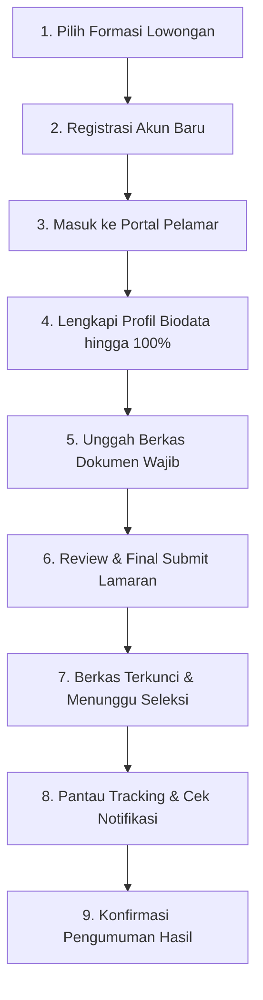

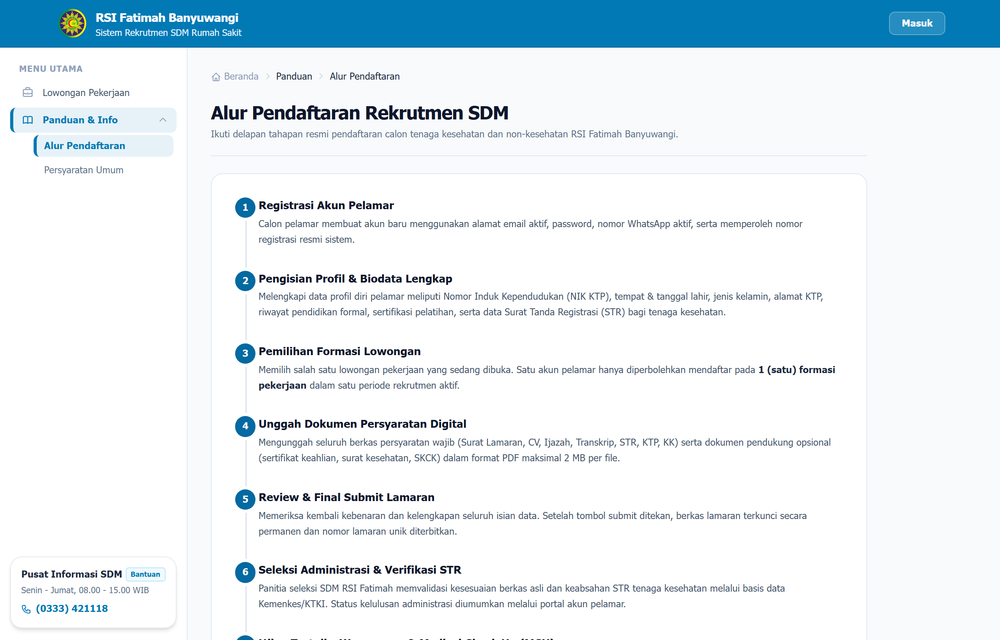

---

## Langkah 1: Eksplorasi Lowongan & Registrasi Akun

### 1.1 Menjelajahi Formasi Lowongan
1. Buka situs web rekrutmen melalui peramban (*browser*) Anda.
2. Klik menu **Lowongan** atau kunjungi tautan `/lowongan`.
3. Anda dapat memfilter posisi berdasarkan unit kerja, kualifikasi pendidikan, maupun status formasi.
4. Klik tombol **Lihat Detail** pada formasi yang diminati untuk memeriksa:
   - Kualifikasi pendidikan minimal dan IPK.
   - Batas usia maksimal.
   - Kebutuhan Surat Tanda Registrasi (STR) bagi profesi kesehatan.
   - Daftar dokumen wajib dan dokumen pendukung yang dipersyaratkan.
   - Tanggal batas akhir pengiriman berkas (*deadline*).

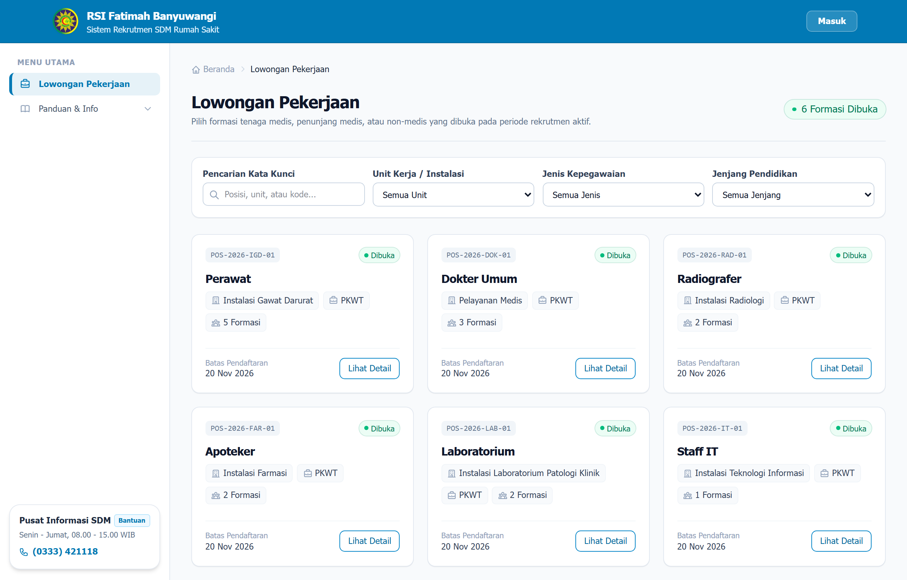

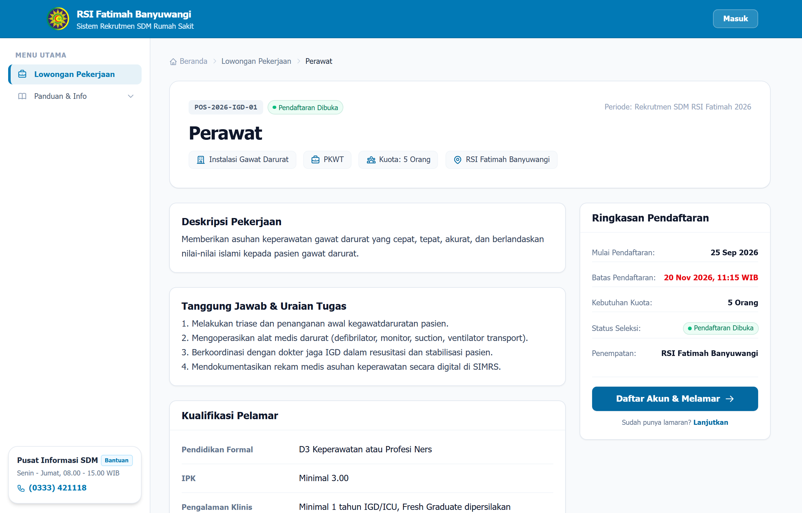

### 1.2 Mendaftar Akun Baru
> **Catatan Penting**: Pendaftaran akun baru di sistem RSI Fatimah terintegrasi langsung dengan posisi lowongan yang dipilih. Anda tidak dapat membuat akun kosong tanpa memilih lowongan.

1. Pada halaman detail formasi lowongan, klik tombol **Lamar Posisi Ini**.
2. Anda akan diarahkan ke formulir **Registrasi Akun Baru** (`/daftar`).
3. Isi data registrasi dengan benar dan teliti:
   - **Nama Lengkap**: Sesuai dengan yang tertera pada e-KTP dan ijazah asli.
   - **Nomor Induk Kependudukan (NIK)**: 16 digit angka e-KTP yang valid (satu NIK hanya dapat didaftarkan satu kali).
   - **Nomor WhatsApp / HP**: Nomor aktif dengan format Indonesia (contoh: `081234567890`) untuk menerima informasi seleksi.
   - **Alamat Email**: Alamat email aktif Anda (digunakan untuk notifikasi dan pemulihan kata sandi).
   - **Kata Sandi (Password)**: Minimal 8 karakter kombinasi huruf dan angka.
   - **Konfirmasi Kata Sandi**: Masukkan kembali kata sandi yang sama persis.
   - **Persetujuan Ketentuan**: Centang persetujuan Syarat & Ketentuan serta Kebijakan Privasi Rekrutmen RSI Fatimah Banyuwangi.
4. Klik tombol **Daftar Akun & Mulai Lamaran**.
5. Sistem akan:
   - Membuat akun Anda secara aman.
   - Menerbitkan **Nomor Registrasi Akun Pelamar** resmi dengan format `PLM-YYYY-XXXXXX` (contoh: `PLM-2026-000001`).
   - Secara otomatis membuat **Draf Lamaran Pekerjaan** untuk posisi yang Anda pilih dan mengarahkan Anda ke menu **Lamaran Saya** (`/portal/lamaran`).

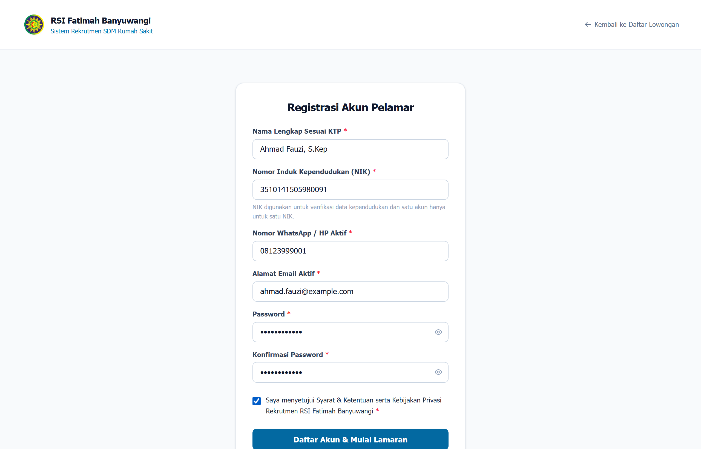

---

## Langkah 2: Masuk (Login) & Pengenalan Dashboard Pelamar

### 2.1 Masuk ke Akun Anda
1. Buka tautan `/masuk`.
2. Masukkan alamat email dan kata sandi yang telah Anda daftarkan.
3. Klik tombol **Masuk**. Sistem akan secara otomatis mengarahkan Anda ke **Dashboard Portal Pelamar** (`/portal`).

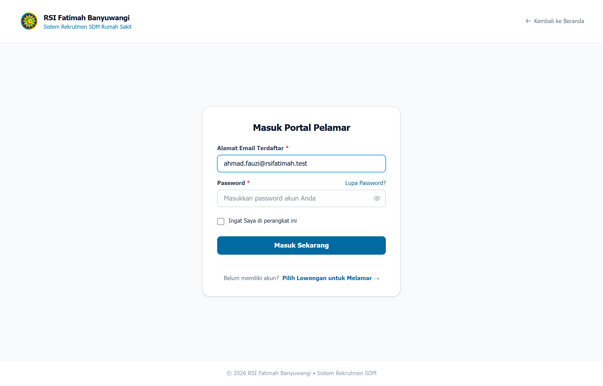

### 2.2 Jika Lupa Kata Sandi
1. Pada halaman login, klik tautan **Lupa Password?** (`/lupa-password`).
2. Masukkan alamat email Anda yang terdaftar, lalu klik **Kirim Tautan Reset Password**.
3. Periksa kotak masuk (atau folder spam/junk) email Anda, buka tautan reset password, lalu buat kata sandi baru.

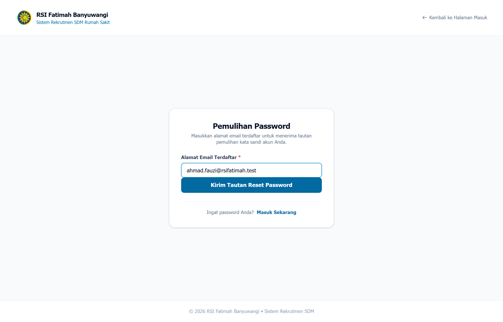

### 2.3 Mengenal Antarmuka Dashboard Pelamar
Di halaman `/portal`, Anda akan melihat:
- **Header Pelamar**: Menampilkan nama lengkap, pas foto, alamat email, dan **Nomor Registrasi Pelamar** (`PLM-YYYY-XXXXXX`).
- **Widget Kelengkapan Profil Dasar**: Menampilkan persentase kesiapan data Anda (0% - 100%).
- **Timeline Alur Seleksi Karyawan**: Grafik dinamis tahapan seleksi aktif beserta batas waktu (*deadline*) pengiriman berkas.
- **Kartu Lamaran Aktif**: Menampilkan formasi yang sedang Anda lamar, status saat ini (*Draft*, *Diajukan*, *Diproses*, dll.), serta tombol akses cepat menuju pengisian berkas.
- **Menu Navigasi Sidebar**: Bilah samping kiri menyediakan akses ke menu **Beranda Portal** (`/portal`), menu **Lamaran Saya** (`/portal/lamaran`) untuk mengelola berkas & status seleksi, menu **Profil Saya** (`/portal/profil`), **Notifikasi** (`/portal/notifikasi`), serta menu bantuan **Panduan & Info** (*Alur Pendaftaran* dan *Persyaratan Berkas*).

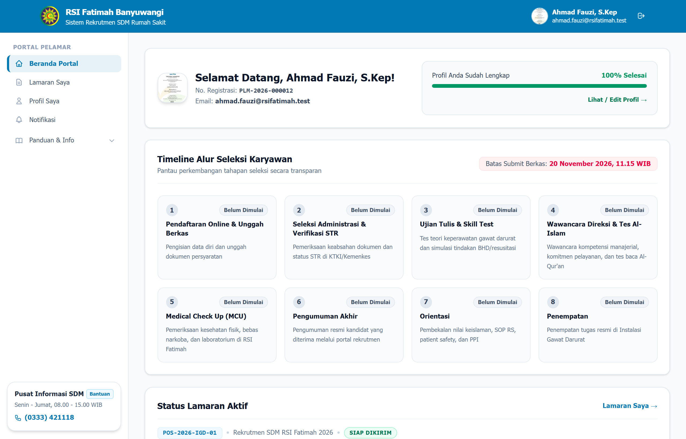

---

## Langkah 3: Pengisian & Pemenuhan Profil Pelamar (Target 100%)

Akses halaman ini melalui menu navigasi **Profil Saya** atau buka tautan `/portal/profil`.

### 💡 Mekanisme Penyimpanan Bertahap (*Incremental Auto-Save*)
Sistem dirancang fleksibel agar pelamar **tidak harus menyelesaikan seluruh data sekaligus dalam satu sesi**:
- **Pas Foto & Data Langsung Tersimpan**: Ketika Anda telah memilih pas foto dan mengisi beberapa data (misalnya nama, tempat/tanggal lahir, kontak), lalu menekan tombol **"Simpan Perubahan"** atau **tidak sengaja menekan tombol Enter** pada keyboard saat mengetik, **pas foto bersama isian data yang telah diinput akan langsung tersimpan secara aman ke server**.
- **Progres Bertambah Sesuai Isian**: Meskipun formulir belum terisi lengkap (misalnya baru 30%, 55%, atau 73%), data yang berhasil disimpan tidak akan hilang. Anda dapat keluar (*logout*) dan melanjutkannya kapan saja.
- **Kapan Profil Harus 100%?**: Tombol **"Menuju ke Pemberkasan"** serta tahapan **Review & Submit Lamaran** baru akan terbuka aktif setelah indikator profil mencapai **100% Selesai**. Periksa daftar kriteria yang belum lengkap di panel ringkasan atas untuk melengkapinya.

### 11 Kriteria Dasar Kelengkapan Profil (100%):
Formulir Profil disatukan dalam **satu halaman terpadu (*Unified Profile Form*)** yang mencakup 11 kriteria wajib berikut:

| No | Kriteria | Keterangan & Ketentuan Sistem |
|:---:|:---|:---|
| 1 | **Pas Foto Formal (3x4)** | Format **JPG, JPEG, PNG, atau WEBP**, ukuran maksimal **5 MB**. Gunakan foto formal berlatar belakang rapi dengan rasio 3:4. Sistem menyediakan *live preview* dan tombol hapus/ganti foto. |
| 2 | **Nama Lengkap** | Sesuai dengan e-KTP dan ijazah asli. |
| 3 | **Nomor Induk Kependudukan (NIK)** | 16 digit angka KTP. **Terkunci permanen** dari data saat pendaftaran akun (tidak dapat diubah mandiri demi integritas 1 Akun = 1 NIK). |
| 4 | **Alamat Email** | Email aktif terdaftar pada akun Anda (dapat diperbarui jika diperlukan). |
| 5 | **Nomor WhatsApp / HP** | Nomor ponsel aktif format Indonesia (contoh: `081234567890`). |
| 6 | **Tempat Lahir** | Nama kota/kabupaten tempat Anda dilahirkan. |
| 7 | **Tanggal Lahir** | Tanggal lahir valid (sebelum hari ini) sesuai KTP. |
| 8 | **Jenis Kelamin** | Pilihan: `Laki-laki` atau `Perempuan`. |
| 9 | **Alamat Sesuai KTP** | Alamat lengkap termasuk RT/RW, kelurahan/desa, kecamatan, dan kota/kabupaten. |
| 10 | **Alamat Domisili** | Tempat tinggal saat ini. Jika tempat tinggal Anda sama dengan KTP, cukup centang opsi *"Alamat domisili saat ini sama dengan alamat KTP"*. |
| 11 | **Minimal 1 Riwayat Pendidikan** | Data pendidikan formal terakhir yang telah diselesaikan (Jenjang: SMA/SMK, D3, D4, S1, Profesi, S2; Nama Institusi/Universitas, Program Studi/Jurusan, Tahun Kelulusan, IPK, dan Akreditasi). |

> **Catatan Berkas Pendukung (STR & Sertifikat Pelatihan)**:
> Bagi tenaga medis/kesehatan, dokumen fisik seperti **Surat Tanda Registrasi (STR)**, **Sertifikat Pelatihan (BTCLS/ACLS/PPGD)**, Surat Pengalaman Kerja, dan CV **tidak diinput terpisah di menu Profil**, melainkan diunggah langsung dalam bentuk **file PDF** pada **Langkah 4: Workspace Pemberkasan**.

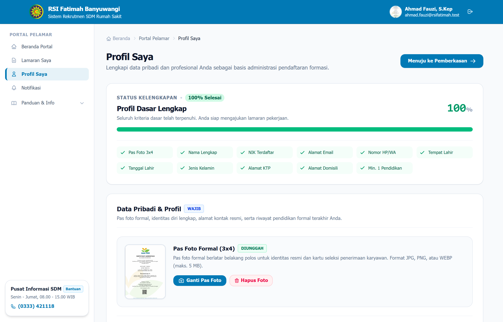

---

## Langkah 4: Manajemen Dokumen & Unggah Berkas Persyaratan

Setelah melengkapi profil hingga 100%, klik tombol **"Menuju ke Pemberkasan"** di pojok kanan atas profil, atau akses melalui menu **Lamaran Saya** &rarr; klik tombol **Pemberkasan** (`/portal/lamaran/{id}/berkas`).

### Aturan Format & Ukuran Berkas:
- **Format File Standar**: Dokumen wajib diunggah dalam format **PDF (.pdf)**.
- **Ukuran Maksimal**: Maksimal **2 MB (2.048 KB)** per file berkas.
- **Kualitas Hasil Pindai (*Scan*)**:
  - Gunakan pemindai dokumen (*scanner*) atau aplikasi pemindai dokumen yang rapi (bukan foto miring/buram).
  - Pastikan teks, nomor registrasi STR, nomor ijazah, tanda tangan, dan cap stempel resmi terbaca jelas.

### Dokumen yang Dipersyaratkan Sesuai Formasi:
> **Catatan Penting**: Daftar berkas persyaratan di bawah ini merupakan contoh referensi lengkap (khususnya untuk tenaga medis/kesehatan). Pada sistem riil, jenis dokumen yang wajib Anda unggah bersifat **dinamis** dan disesuaikan secara otomatis dengan posisi formasi lowongan yang Anda pilih.

1. **Berkas Wajib Umum**:
   - Surat Lamaran Pekerjaan (ditujukan kepada Direktur RSI Fatimah Banyuwangi).
   - Daftar Riwayat Hidup / Curriculum Vitae (CV) terbaru.
   - Scan Ijazah Asli Pendidikan Terakhir.
   - Scan Transkrip Nilai Akademik Asli.
   - Scan e-KTP Asli.
   - Scan Kartu Keluarga (KK).
2. **Berkas Khusus Tenaga Kesehatan**:
   - Scan Surat Tanda Registrasi (STR) aktif (KKI / KTKI / Kemenkes).
   - Scan Sertifikat Pelatihan Keahlian (contoh: BTCLS, ACLS, ATLS) jika dipersyaratkan.
3. **Berkas Tambahan / Opsional**:
   - Surat Keterangan Catatan Kepolisian (SKCK) aktif.
   - Surat Keterangan Sehat dari Dokter / Rumah Sakit.
   - Surat Bebas Narkoba.

### Cara Mengunggah & Memeriksa Berkas:
1. Pada baris dokumen yang ingin diunggah, klik tombol **Pilih File**, cari berkas PDF dari perangkat Anda, lalu klik **Unggah Berkas**.
2. Indikator progres akan meningkat seiring kelengkapan berkas wajib.
3. Klik tombol **Preview / Unduh** untuk memastikan file yang Anda unggah benar dan tidak tertukar.
4. Jika ingin mengganti file, cukup pilih file baru dan klik **Ganti File**, atau klik **Hapus** selama status lamaran masih **DRAFT**.

### Fitur Pembatalan Draf Lamaran:
Jika Anda ingin membatalkan draf lamaran sebelum disubmit, Anda dapat melakukannya melalui tombol **Batalkan Draf Lamaran** pada halaman detail lamaran.
*(Perhatian: Sesuai kebijakan sistem RSI Fatimah, akun pelamar wajib terikat pada lamaran aktif. Jika Anda membatalkan satu-satunya draf lamaran Anda, akun dan berkas sementara akan dihapus secara otomatis dan sesi Anda akan diakhiri).*

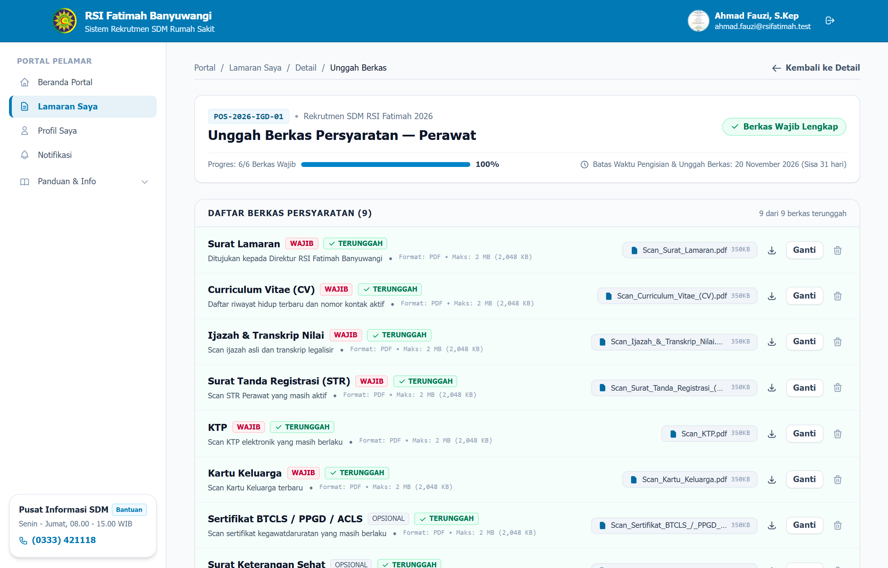

---

## Langkah 5: Peninjauan (Review) & Final Submit Lamaran

Setelah seluruh berkas wajib terunggah dan profil terisi 100%, tombol **"Lanjut ke Step 3: Review & Kirim"** pada halaman berkas akan aktif.

1. Buka halaman review melalui tautan `/portal/lamaran/{id}/review`.
2. Periksa kembali seluruh data yang dirangkum:
   - Data formasi lowongan dan unit kerja tujuan.
   - Data profil pribadi, kontak, dan riwayat pendidikan terakhir.
   - Daftar seluruh dokumen persyaratan yang telah diunggah.
3. **Pernyataan Integritas & Kebenaran Data**:
   - Baca pakta integritas pelamar.
   - Centang kotak pernyataan persetujuan:
     *"Saya menyatakan dengan sesungguhnya bahwa seluruh data dan dokumen yang saya unggah adalah benar, sah, dan dapat dipertanggungjawabkan..."*
4. **Final Submit (Kirim Lamaran)**:
   - Klik tombol **Kirim Lamaran Sekarang**.
   - Muncul dialog konfirmasi akhir peringatan penguncian data. Klik **Ya, Kirim Lamaran**.
5. **Penerbitan Nomor Lamaran Resmi**:
   - Sistem secara atomik mengunci data (*snapshot snapshot* permanen) dan menerbitkan **Nomor Lamaran Resmi** dengan format:
     `LAM-{KODE_PERIODE}-{NOMOR_URUT_6}` (contoh: `LAM-2026-A-000001`).

> **PERINGATAN PENTING**:
> Setelah tombol **Kirim Lamaran** ditekan:
> 1. Status lamaran Anda resmi berubah dari **DRAFT** menjadi **SUBMITTED (Lamaran Terkirim)**.
> 2. Berkas lamaran Anda **TERKUNCI SECARA PERMANEN**. Anda tidak dapat lagi mengubah isian profil untuk lamaran tersebut maupun mengunggah ulang dokumen berkas.
> 3. Salinan resmi (*snapshot*) berkas Anda dibekukan dan diteruskan ke Tim Seleksi SDM / SDI RSI Fatimah Banyuwangi untuk proses verifikasi.

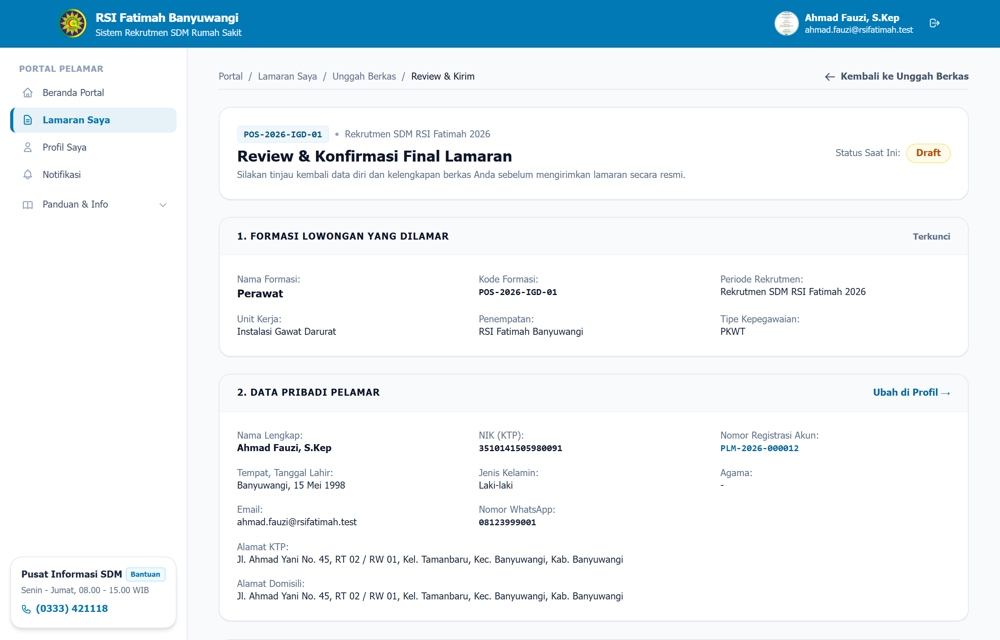

---

## Langkah 6: Pemantauan Seleksi (Tracking & Hasil Pengumuman)

Setelah lamaran terkirim, Anda dapat memantau setiap perkembangan tahapan seleksi secara *real-time*.

Akses melalui menu **Lamaran Saya** &rarr; klik tombol **Tracking Lamaran** (`/portal/lamaran/{id}/tracking`).

### Tahapan Seleksi RSI Fatimah Banyuwangi:
Setiap lowongan memiliki tahapan seleksi yang terstruktur, umumnya mencakup:
1. **Seleksi Administrasi & Verifikasi STR**:
   Pemeriksaan keabsahan dokumen asli, kesesuaian kualifikasi pendidikan, serta keabsahan STR tenaga kesehatan melalui basis data Kemenkes/KTKI.
2. **Ujian Tertulis & Tes Kemampuan Bidang (TKB) / Skill Test**:
   Tes teori profesi, tes psikotes dasar, atau simulasi keterampilan klinis.
3. **Wawancara Direksi & Tes Al-Islam / Kemuhammadiyahan**:
   Wawancara kompetensi, komitmen kerja pelayanan islami, serta tes kemampuan membaca Al-Qur'an.
4. **Pemeriksaan Kesehatan / Medical Check-Up (MCU)**:
   Pemeriksaan fisik, laboratorium, dan tes bebas narkoba di RSI Fatimah Banyuwangi.
5. **Pengumuman Akhir, Orientasi & Penempatan**:
   Penetapan kelulusan final, kontrak kerja (PKWT), masa orientasi karyawan baru, dan penempatan unit kerja.

### Kebijakan Pengumuman Terjadwal (*Publication Gate / Anti-Leak*):
- Sistem menerapkan gerbang publikasi berbasis waktu (*time-aware publication gate*).
- Hasil penilaian tahapan dan pengumuman akhir hanya akan tampil pada portal pelamar **tepat pada tanggal dan jam publikasi resmi** yang telah ditetapkan oleh Tim Panitia SDM. Sebelum waktu pengumuman tiba, status lamaran tetap berstatus aman *"Menunggu Pengumuman"*.

### Arti Indikator Status pada Portal:
- 🟡 **Kuning (*Draft Lamaran*)**: Draf lamaran masih dalam proses pengisian oleh pelamar dan belum dikirim resmi.
- 🔵 **Biru (*Lamaran Terkirim / Submitted*)**: Berkas berhasil dikirim dan masuk dalam antrean penilaian panitia.
- 🟣 **Ungu (*Proses Seleksi / In Process*)**: Berkas atau kandidat sedang dalam proses penilaian tahapan seleksi aktif.
- 🩵 **Biru Muda / Sky (*Menunggu Pengumuman Akhir*)**: Penilaian seleksi telah dievaluasi panitia, namun pengumuman resmi masih menunggu waktu publikasi sesuai jadwal yang ditetapkan (*Publication Gate / Anti-Leak*).
- 🟢 **Hijau (*Diterima / Lolos*)**: Dinyatakan lolos pada tahapan tersebut atau dinyatakan diterima resmi sebagai calon karyawan baru.
- 🔴 **Merah (*Tidak Lolos*)**: Belum memenuhi kualifikasi pada tahapan seleksi yang diikuti.
- ⚪ **Abu-abu / Slate (*Tidak Dilanjutkan*)**: Status tahapan seleksi bagi pelamar yang belum memenuhi kualifikasi pada tahapan sebelumnya sehingga proses seleksi berikutnya tidak dilanjutkan.

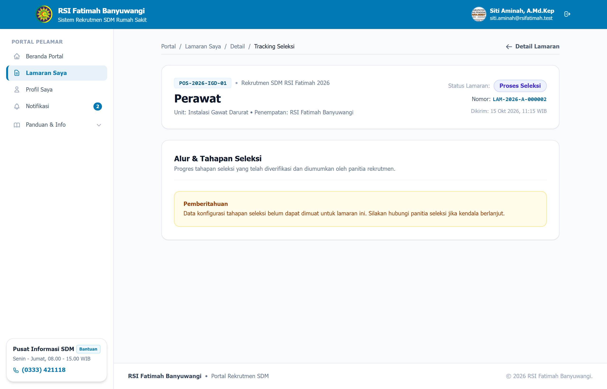

---

## Langkah 7: Konfirmasi Pengumuman & Kebijakan Siklus Akun

RSI Fatimah menerapkan kebijakan perlindungan data pribadi dan siklus hidup akun (*Data Privacy & Lifecycle Policy*):

### Konfirmasi Membaca Pengumuman (Acknowledge)
Pada kartu banner maupun modal pop-up pengumuman hasil seleksi di portal pelamar:
- Pelamar diwajibkan mengklik tombol konfirmasi penolakan: **"Konfirmasi & Akhiri Akun"** atau **"Saya Mengerti, Konfirmasi & Akhiri Akun"**.
- Waktu konfirmasi Anda akan dicatat ke sistem secara otomatis (`announcement_seen_at`).

### Kebijakan Siklus Akun Setelah Seleksi:
1. **Bagi Pelamar yang Diterima (Lolos Akhir)**:
   - Data profil pelamar diekspor secara resmi ke sistem kepegawaian internal rumah sakit (SDI).
   - Akses portal pelamar akan diarsipkan setelah resmi bertugas.
2. **Bagi Pelamar yang Belum Lolos**:
   - Setelah pelamar mengonfirmasi membaca pengumuman penolakan melalui tombol konfirmasi, sistem akan secara otomatis menutup sesi login pelamar.
   - Sesuai regulasi privasi data RSI Fatimah Banyuwangi, seluruh dokumen berkas digital (*file upload*) dan akun pendaftaran akan dibersihkan (*cleanup*) secara aman dari server, sehingga data pribadi pelamar tidak tersimpan tanpa batas waktu.

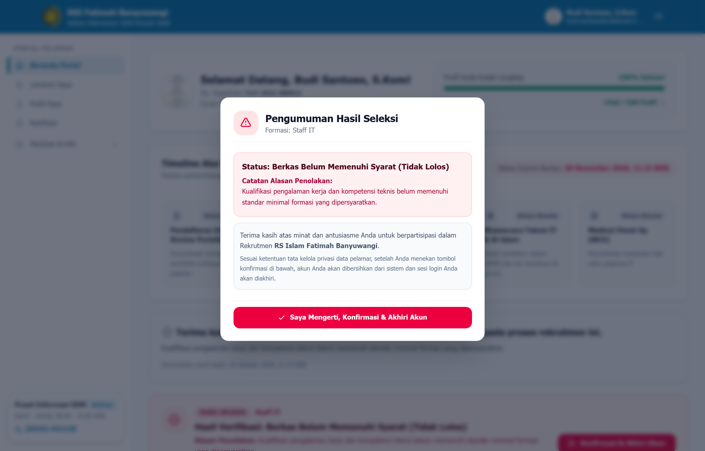

---

## 10. Pusat Notifikasi

Sistem menggunakan pemberitahuan ganda (*Dual-Channel Notification*):
1. **Notifikasi di Dalam Aplikasi (In-App Notification)**:
   - Diakses melalui menu **Notifikasi** (berikon lonceng dengan indikator jumlah pesan belum dibaca) pada bilah menu navigasi samping (Sidebar) sebelah kiri untuk versi desktop atau melalui menu laci (*drawer*) pada perangkat ponsel pintar (`/portal/notifikasi`).
   - Pojok kanan atas bilah navigasi hanya memuat foto profil pelamar dan tombol keluar (*logout*).
   - Notifikasi otomatis masuk saat:
     * Draf lamaran berhasil dibuat.
     * Lamaran berhasil dikirim resmi (final submit).
     * Berkas selesai diverifikasi oleh panitia.
     * Hasil pengumuman setiap tahapan seleksi diterbitkan.
   - Dilengkapi tombol aksi **Lihat Detail** dan fitur **Tandai Semua Sudah Dibaca** untuk mengelola notifikasi.
2. **Notifikasi Email Resmi**:
   - Dikirimkan secara otomatis ke alamat email yang Anda daftarkan saat ada pembaruan status penting atau instruksi pelaksanaan tahapan berikutnya.
   - Selalu periksa folder **Kotak Masuk (Inbox)** dan folder **Spam/Promotions**.

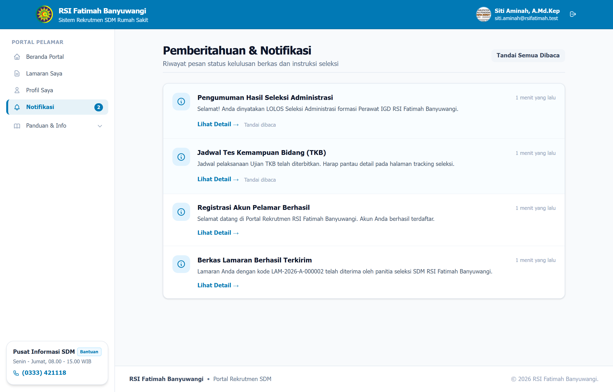

---

## 11. Tanya Jawab & Pemecahan Masalah (FAQ & Troubleshooting)

### Q1: Mengapa muncul pesan "Pendaftaran akun baru dilakukan saat memilih lowongan yang ingin dilamar"?
**Jawab**: Anda tidak dapat mendaftar akun kosong tanpa memilih posisi. Kunjungi menu **Lowongan** (`/lowongan`), pilih formasi yang diminati, lalu klik **Lamar Posisi Ini**. Formulir pendaftaran akun akan terbuka otomatis dan langsung mengaitkan draf lamaran pada posisi tersebut.

### Q2: Mengapa tombol "Kirim Lamaran" di halaman Review atau "Menuju ke Pemberkasan" di Profil tidak dapat diklik?
**Jawab**: Pastikan seluruh syarat berikut terpenuhi:
1. Kelengkapan Profil Dasar Anda sudah mencapai **100% Selesai** (semua 11 kriteria terpenuhi).
2. Seluruh dokumen berkas bertanda **Wajib** pada menu Pemberkasan telah berhasil diunggah.
3. Anda telah **mencentang kotak pernyataan kebenaran data** di halaman Review.
4. Masa periode pendaftaran lowongan masih dalam masa buka (belum melewati batas waktu/deadline).

### Q3: Berapa ukuran maksimal dan format file pas foto dan dokumen berkas?
**Jawab**:
- **Pas Foto Profil**: Format **JPG, JPEG, PNG, atau WEBP**, ukuran maksimal **5 MB (5.120 KB)**.
- **Dokumen Berkas Persyaratan**: Format **PDF (.pdf)**, ukuran maksimal **2 MB (2.048 KB)** per file berkas.

### Q4: Mengapa Nomor Induk Kependudukan (NIK) pada halaman Profil tidak dapat diedit?
**Jawab**: NIK bersifat permanen dan menjadi identitas tunggal Anda di sistem rekrutmen RSI Fatimah (prinsip 1 NIK = 1 Akun). NIK telah terverifikasi sejak pendaftaran akun baru demi mencegah duplikasi pendaftaran.

### Q5: Di mana saya mengisi data STR dan Sertifikat Pelatihan? Mengapa tidak ada tombol "Tambah STR" di Profil?
**Jawab**: Pengisian profil dasar berfokus pada data identitas, kontak, dan pendidikan formal terakhir. Dokumen STR (Surat Tanda Registrasi) dan Sertifikat Pelatihan (BTCLS/ACLS/dll.) diunggah langsung dalam bentuk **file PDF** pada **Langkah 4: Workspace Pemberkasan** (`/portal/lamaran/{id}/berkas`).

### Q6: Bagaimana jika saya tidak sengaja menekan tombol Enter atau Simpan saat data belum terisi semua?
**Jawab**: Anda tidak perlu khawatir! Sistem menerapkan penyimpanan bertahap (*incremental save*). Pas foto dan data apa pun yang sudah Anda input akan langsung tersimpan aman ke server. Persentase kelengkapan profil Anda akan otomatis bertambah (misalnya menjadi 45% atau 73%). Anda dapat melanjutkan pengisian kapan saja hingga mencapai 100%.

### Q7: Apakah saya bisa membatalkan atau mengubah lamaran setelah tombol "Kirim Lamaran" ditekan?
**Jawab**: **Tidak bisa**. Setelah tombol *Kirim Lamaran* ditekan, status berubah menjadi *SUBMITTED* dan berkas **terkunci permanen** (*snapshot frozen*) demi menjaga objektivitas seleksi. Selalu teliti dan periksa kembali melalui tombol *Preview* sebelum mengirimkan lamaran.

### Q8: Bagaimana jika saya lupa kata sandi akun?
**Jawab**: Buka halaman login (`/masuk`), klik tautan **Lupa Password?**, masukkan alamat email terdaftar Anda, dan ikuti instruksi pengaturan ulang kata sandi yang dikirimkan ke kotak masuk email Anda.

---

### Saluran Bantuan Resmi (Helpdesk)
Apabila Anda mengalami kendala teknis di luar panduan ini, silakan menghubungi:
- **Panitia Seleksi SDM RSI Fatimah Banyuwangi**
- **Alamat**: Jl. Jember No. 25, Kalirejo, Kab. Banyuwangi, Jawa Timur
- **Situs Web**: [Portal Rekrutmen RSI Fatimah](file:///d:/projek/system-require-rsifatimah)
